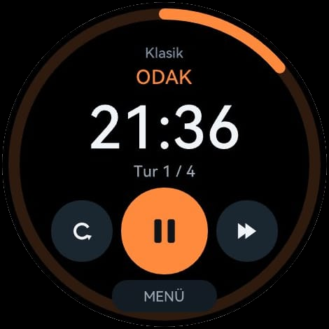
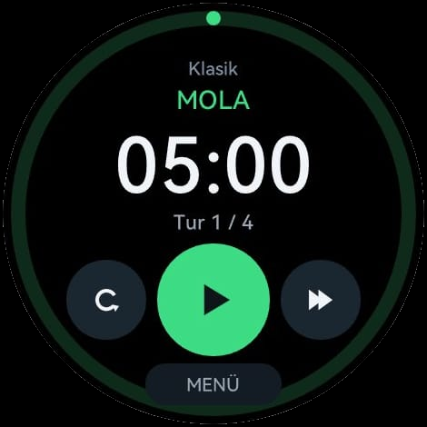
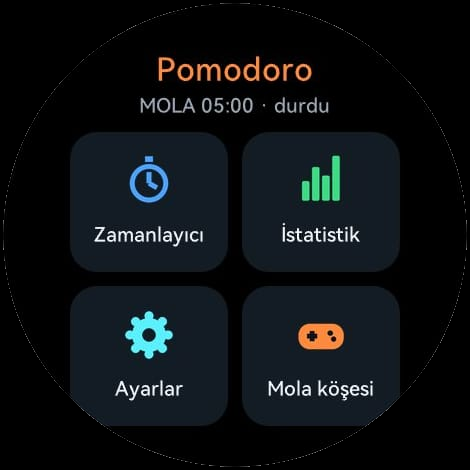
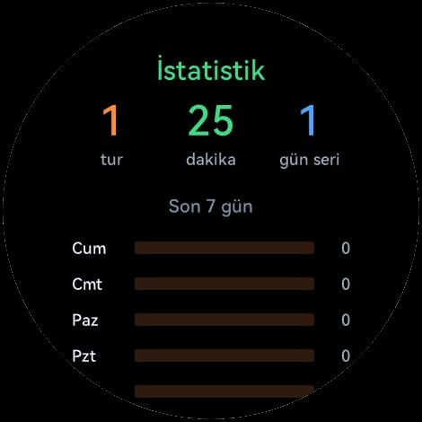
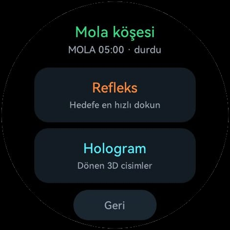

# Pomodoro Odak

Huawei Watch GT 6 için bileğinde Pomodoro odak zamanlayıcısı. Çalışmayı odak turlarına ve molalara böler, tur bitince titrer, ilerlemeni saatte tutar.

<p align="center">
  
  
  
</p>
<p align="center">
  
  
</p>

- **Renkli ilerleme halkası:** odakta turuncu, molada yeşil, uzun molada mavi
- **Titreşim:** tur bitince uzun, son dakikada kısa uyarı; düğmelere basınca dokunma hissi
- **Hazır ayarlar:** Klasik 25/5, Derin 50/10, Kısa 15/3 ya da kendi sürelerin; dört turda bir uzun mola
- **İstatistik:** bugünkü turlar ve dakikalar, seri, son 7 günün grafiği
- **Mola köşesi:** refleks oyunu ve dönen 3D hologramlar
- **Kesintisiz süre:** menüde gezinirken ya da ekran kararınca sayar; uygulama kapanıp açılınca kaldığı yerden sürer
- **Gizlilik:** internete bağlanmaz, veri toplamaz. [Gizlilik politikası](https://ahmetkurtbm.github.io/pomodoro-odak/magaza/gizlilik.html)

Kontroller: sağdan sola kaydırınca menü, soldan sağa kaydırınca geri (zamanlayıcı ekranında uygulamadan çıkış).

## Klasörler

```
watch/                    DevEco Studio projesi (HarmonyOS lite wearable, HML + CSS + JS)
  entry/src/main/js/MainAbility/
    common/engine.js      Pomodoro motoru: süre, aşamalar, titreşim, kayıt, istatistik
    common/store.js       kalıcı kayıt (@system.storage)
    common/frames/        hologram kareleri (tools/ ile üretilir)
    common/icons/         düğme simgeleri (tools/make-icons.py)
    pages/                index (zamanlayıcı), menu, ayarlar, istatistik, mola, refleks, holo
  KURULUM.md              saate debug kurulumu: imza, yükleme, bilinen sorunlar
  YAYIN.md                AppGallery'de yayınlama adımları
magaza/                   mağaza simgeleri, metinler, gizlilik politikası
prototype/                3D hologram ve formül motorunun tarayıcı prototipi
tools/                    hologram kare üreticisi, simge çizici, çekirdek kopyalayıcı
```

## Derleme

1. DevEco Studio ile `watch/` klasörünü aç.
2. `watch/build-profile.example.json5` dosyasını `build-profile.json5` olarak kopyala ve kendi imza ayarını gir. Gerçek ayar dosyası şifre içerdiği için depoda yok.
3. Saate yükleme: [watch/KURULUM.md](watch/KURULUM.md). Mağaza paketi: [watch/YAYIN.md](watch/YAYIN.md).

Paket adı `com.ahmet.bilekholo`, projenin ilk adından kaldı. AppGallery'de değiştirilemiyor, kullanıcılar görmüyor.

## GT 6'da öğrendiklerimiz

GT 6, üçüncü parti uygulamalar için yalnızca **lite wearable** (JS) çalıştırıyor ve bu platformun sürprizleri var. Ayrıntılar [KURULUM.md](watch/KURULUM.md) içinde:

- Uygulama iki simge ister: `icon.png` 104×104 ve `icon_small.png` 92×92. Yoksa kurulum "40. Invalid configuration file format" hatası verir.
- JavaScript motoru regex desteklemez. Kodda regex varsa "34. Internal error" çıkar.
- Canvas her çizim komutunu bellekte tutar. Animasyon birkaç saniyede saati çökertir; bu yüzden halka hazır `progress` bileşeni, hologram ise önceden çizilmiş resimler.
- `class="{{...}}"` bağlama ve `:active` stili çalışmaz. Bunların yerine `show` ve titreşim kullanılır.
- İvmeölçer üçüncü parti uygulamaya `0 0 0` verir. Titreşim, kayıt ve ekranı açık tutma ise çalışır.
